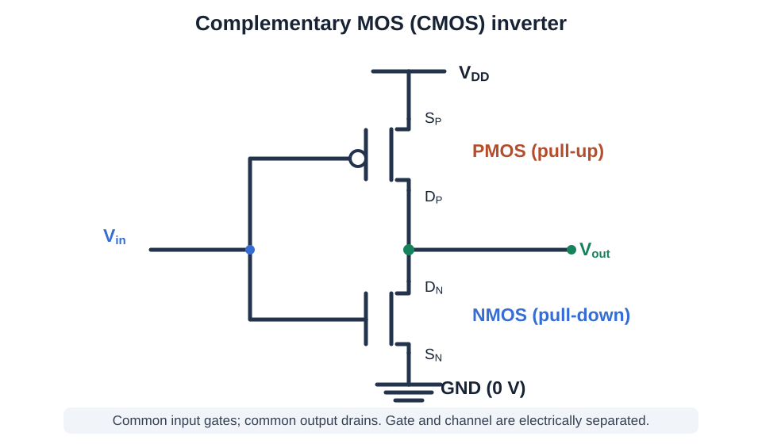
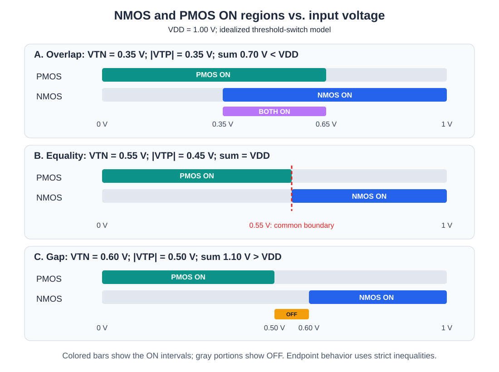
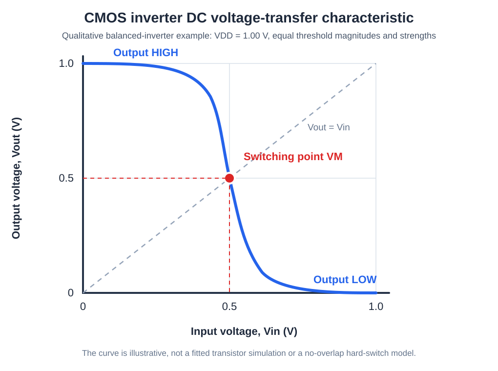

# CMOS Inverter: From MOSFET Physics to the Threshold-Overlap Condition

> **EECS 16B learning notes.** This is a self-contained derivation of how an NMOS and a PMOS form a NOT gate and, in particular, why an instructor might assume
>
> $$
> \boxed{V_{TN}+|V_{TP}|\ge V_{DD}.}
> $$
>
> **Critical distinction:** This inequality guarantees **at most one** transistor is ON in the ideal threshold-switch model. It does **not** guarantee **exactly one** is ON. If the inequality is strict, there is an input-voltage interval where **both are OFF**. Practical CMOS inverters generally *do* have an overlap-conduction region during a transition.

## Contents

1. [What an inverter must do](#1-what-an-inverter-must-do)
2. [MOSFET basics from the ground up](#2-mosfet-basics-from-the-ground-up)
3. [Building the CMOS inverter](#3-building-the-cmos-inverter)
4. [Deriving the NMOS and PMOS ON conditions](#4-deriving-the-nmos-and-pmos-on-conditions)
5. [The two stable logic states](#5-the-two-stable-logic-states)
6. [The instructor's inequality: two rigorous proofs](#6-the-instructors-inequality-two-rigorous-proofs)
7. [All three threshold cases, with a voltage-axis visualization](#7-all-three-threshold-cases-with-a-voltage-axis-visualization)
8. [Worked numerical examples](#8-worked-numerical-examples)
9. [What actually happens at the output node?](#9-what-actually-happens-at-the-output-node)
10. [A more realistic model: MOSFET currents and switching point](#10-a-more-realistic-model-mosfet-currents-and-switching-point)
11. [Capacitance, transient behavior, and power](#11-capacitance-transient-behavior-and-power)
12. [Limitations, common mistakes, and practical design](#12-limitations-common-mistakes-and-practical-design)
13. [Practice problems and complete solutions](#13-practice-problems-and-complete-solutions)
14. [One-page recap](#14-one-page-recap)

---

## 1. What an inverter must do

An **inverter** is a digital logic element that implements the NOT operation. Its ideal truth table is:

| Logic input $A$ | Logic output $Y$ |
|:---:|:---:|
| $0$ (LOW) | $1$ (HIGH) |
| $1$ (HIGH) | $0$ (LOW) |

Equivalently, $Y=\overline{A}$.

In a physical circuit, logic levels are represented by **ranges of voltages**, rather than abstract symbols. In our idealized example:

- LOW corresponds to approximately $0\ \mathrm V$.
- HIGH corresponds to approximately $V_{DD}$, the positive supply voltage.
- $V_{SS}=0\ \mathrm V$ is our ground/reference rail.
- $V_{\mathrm{in}}$ is the externally driven input voltage.
- $V_{\mathrm{out}}$ is the circuit's output-node voltage.

A CMOS inverter uses **two complementary transistors** so that one can connect the output to the positive rail and the other can connect it to ground.

**We are discussing a digital NOT gate**, not a DC-to-AC electrical power inverter.

## 2. MOSFET basics from the ground up

### 2.1 The four terminals

A MOSFET (metal–oxide–semiconductor field-effect transistor) has four physical terminals:

| Terminal | Symbol | Main role |
|---|---|---|
| Gate | $G$ | Electric field controls formation of the conducting channel |
| Source | $S$ | Reference terminal for gate-to-source voltage |
| Drain | $D$ | Other end of the conducting channel |
| Body/bulk | $B$ | Semiconductor substrate/well; affects threshold through body bias |

A schematic often draws only $G$, $S$, and $D$ because the body is implicitly connected to a supply rail. In conventional CMOS, an NMOS body is usually tied to the lowest potential and a PMOS body/well to the highest.

The gate is insulated from the semiconductor by a thin dielectric. The applied **gate voltage creates an electric field** that controls conduction in a channel between source and drain. Therefore, the gate is not an ordinary resistive input through which the main drain current flows. An ideal MOS gate draws no DC current, although its capacitance must be charged and discharged when switching.

### 2.2 Why NMOS and PMOS respond in opposite directions

For an **enhancement-mode NMOS**, a sufficiently *positive* gate relative to its source creates an electron inversion channel. The familiar strong-inversion condition is

$$
V_{GS,N}>V_{TN},
$$

where

$$
V_{GS,N}=V_{G,N}-V_{S,N}
$$

and $V_{TN}$ is the NMOS threshold voltage (assumed positive here).

For an **enhancement-mode PMOS**, a sufficiently *negative* gate relative to its source creates a hole inversion channel. We can write its condition without juggling negative numbers:

$$
V_{SG,P}>|V_{TP}|,
$$

where

$$
V_{SG,P}=V_{S,P}-V_{G,P}
$$

and $V_{TP}$ is conventionally negative. The positive quantity $|V_{TP}|$ denotes its magnitude.

The same PMOS condition could instead be expressed as $V_{GS,P}<V_{TP}$, provided the sign convention is maintained consistently.

### 2.3 What does “ON” mean?

For our instructor's **ideal threshold-switch model**:

- ON means the gate overdrive exceeds the threshold, so we model the device as a conducting switch.
- OFF means the gate overdrive does not exceed the threshold, so we model it as an open circuit.
- We use strict inequalities ($>$). At equality, the ideal switch is taken to be OFF.

This is a **modeling convention**, not a claim that physical current jumps abruptly from exactly zero to a large value at threshold. Real MOSFETs exhibit subthreshold conduction and leakage, and their ON-state resistance is not constant. We revisit this later.

## 3. Building the CMOS inverter

The connections are:

| Connection | PMOS (top) | NMOS (bottom) |
|---|---|---|
| Gate | $V_{\mathrm{in}}$ | $V_{\mathrm{in}}$ |
| Source | $V_{DD}$ | $V_{SS}=0$ |
| Drain | $V_{\mathrm{out}}$ | $V_{\mathrm{out}}$ |
| Body (usual CMOS arrangement) | $V_{DD}$ | $V_{SS}=0$ |

Why this layout?

1. The **top PMOS** is a *pull-up*: when ON, it connects the output to $V_{DD}$.
2. The **bottom NMOS** is a *pull-down*: when ON, it connects the output to ground.
3. Connecting their **gates** gives them the **same input voltage**.
4. Connecting their **drains** allows whichever transistor is conducting to control the output.
5. Because their gate-to-source voltages differ, they respond oppositely to the same gate voltage.

Do not confuse **same gate voltage** with **same gate-to-source voltage**: the PMOS source is at $V_{DD}$, while the NMOS source is at $0\ \mathrm V$.

We assume $0\le V_{\mathrm{in}}\le V_{DD}$, fixed supply rails, enhancement-mode devices, and no body-effect change in thresholds unless explicitly stated.

## 4. Deriving the NMOS and PMOS ON conditions

This section is the foundation of the entire argument. Derive the inequalities; do **not** memorize them without checking the terminal voltages.

### 4.1 NMOS: derive from $V_{GS,N}$

The transistor model says

$$
\text{NMOS ON}\quad\Longleftrightarrow\quad V_{GS,N}>V_{TN}.
$$

By the circuit wiring,

$$
V_{G,N}=V_{\mathrm{in}},\qquad V_{S,N}=V_{SS}=0.
$$

Use the definition of gate-to-source voltage:

$$
\begin{aligned}
V_{GS,N}
&=V_{G,N}-V_{S,N}\\
&=V_{\mathrm{in}}-0\\
&=V_{\mathrm{in}}.
\end{aligned}
$$

Substitute into the threshold criterion:

$$
\boxed{\text{NMOS ON}\quad\Longleftrightarrow\quad V_{\mathrm{in}}>V_{TN}.}
$$

Its complementary ideal-OFF condition is

$$
\boxed{\text{NMOS OFF}\quad\Longleftrightarrow\quad V_{\mathrm{in}}\le V_{TN}.}
$$

In particular, **a high input turns the NMOS ON**.

### 4.2 PMOS: derive from $V_{SG,P}$

The PMOS model says

$$
\text{PMOS ON}\quad\Longleftrightarrow\quad V_{SG,P}>|V_{TP}|.
$$

By the wiring,

$$
V_{S,P}=V_{DD},\qquad V_{G,P}=V_{\mathrm{in}}.
$$

Then

$$
\begin{aligned}
V_{SG,P}
&=V_{S,P}-V_{G,P}\\
&=V_{DD}-V_{\mathrm{in}}.
\end{aligned}
$$

Apply the threshold criterion:

$$
V_{DD}-V_{\mathrm{in}}>|V_{TP}|.
$$

Subtract $V_{DD}$ on both sides and multiply by $-1$, which **reverses** the inequality:

$$
\begin{aligned}
-V_{\mathrm{in}}&>|V_{TP}|-V_{DD},\\
V_{\mathrm{in}}&<V_{DD}-|V_{TP}|.
\end{aligned}
$$

Thus

$$
\boxed{\text{PMOS ON}\quad\Longleftrightarrow\quad V_{\mathrm{in}}<V_{DD}-|V_{TP}|.}
$$

The ideal-OFF condition is

$$
\boxed{\text{PMOS OFF}\quad\Longleftrightarrow\quad V_{\mathrm{in}}\ge V_{DD}-|V_{TP}|.}
$$

In particular, **a low input turns the PMOS ON**.

### 4.3 Put the two results side by side

Define two input boundaries for convenience:

$$
a:=V_{TN}\qquad\text{and}\qquad b:=V_{DD}-|V_{TP}|.
$$

Then

| Device | ON condition | OFF condition |
|---|---|---|
| NMOS | $V_{\mathrm{in}}>a$ | $V_{\mathrm{in}}\le a$ |
| PMOS | $V_{\mathrm{in}}<b$ | $V_{\mathrm{in}}\ge b$ |

Remember: **$a$ is where NMOS begins conducting; $b$ is where PMOS stops conducting**, as the input is swept upward.

## 5. The two stable logic states

Suppose $V_{DD}=1.00\ \mathrm V$ and each device's threshold magnitude is $0.35\ \mathrm V$. First analyze the two digital input endpoints.

### 5.1 Input LOW: $V_{\mathrm{in}}=0$

NMOS:

$$
V_{GS,N}=V_{\mathrm{in}}-0=0-0=0\ \mathrm V.
$$

Because $0\not>0.35$, the NMOS is **OFF**.

PMOS:

$$
V_{SG,P}=V_{DD}-V_{\mathrm{in}}=1.00-0=1.00\ \mathrm V.
$$

Because $1.00>0.35$, the PMOS is **ON**.

The output is pulled toward the positive supply through the PMOS:

$$
\boxed{V_{\mathrm{out}}\approx V_{DD}=1.00\ \mathrm V.}
$$

Therefore the logic output is HIGH, the inverse of the LOW input.

### 5.2 Input HIGH: $V_{\mathrm{in}}=V_{DD}=1.00\ \mathrm V$

NMOS:

$$
V_{GS,N}=1.00-0=1.00\ \mathrm V>0.35\ \mathrm V.
$$

Therefore NMOS is **ON**.

PMOS:

$$
V_{SG,P}=1.00-1.00=0\ \mathrm V\not>0.35\ \mathrm V.
$$

Therefore PMOS is **OFF**.

The output is pulled to ground through the NMOS:

$$
\boxed{V_{\mathrm{out}}\approx V_{SS}=0\ \mathrm V.}
$$

Therefore the logic output is LOW, the inverse of the HIGH input.

### 5.3 Ideal logic truth table

| $V_{\mathrm{in}}$ | PMOS | NMOS | Ideal $V_{\mathrm{out}}$ |
|---|---|---|---|
| $0$ | ON | OFF | $V_{DD}$ |
| $V_{DD}$ | OFF | ON | $0$ |

**Important:** This logic truth table covers *valid low and high inputs*. It does **not** by itself tell us what happens at every intermediate analog voltage. The threshold-overlap calculation handles that question.

## 6. The instructor's inequality: two rigorous proofs

The assumption in question is

$$
\boxed{V_{TN}+|V_{TP}|\ge V_{DD}.}
$$

We want to know precisely why it prevents the two devices from being ON simultaneously in the ideal model.

### 6.1 Proof 1: simultaneous inequalities and interval existence

For **both** transistors to be ON, both of these must hold:

$$
\begin{cases}
V_{\mathrm{in}}>V_{TN}, &\text{(NMOS)}\\
V_{\mathrm{in}}<V_{DD}-|V_{TP}|. &\text{(PMOS)}
\end{cases}
$$

Combine them into a single interval:

$$
\boxed{V_{TN}<V_{\mathrm{in}}<V_{DD}-|V_{TP}|.}
$$

This interval contains at least one real number **if and only if** its left endpoint is strictly less than its right endpoint:

$$
V_{TN}<V_{DD}-|V_{TP}|.
$$

Add $|V_{TP}|$ to both sides:

$$
\boxed{V_{TN}+|V_{TP}|<V_{DD}.}
$$

So the **necessary and sufficient condition for a nonempty both-ON interval** (within the assumed rail-to-rail range and conventional positive thresholds) is that the threshold sum is *less than* the supply.

Its logical negation is

$$
\neg\big(V_{TN}+|V_{TP}|<V_{DD}\big)
\quad\Longleftrightarrow\quad
V_{TN}+|V_{TP}|\ge V_{DD}.
$$

Hence

$$
\boxed{
V_{TN}+|V_{TP}|\ge V_{DD}
\quad\Longrightarrow\quad
\text{both cannot be ON together}.
}
$$

This is exactly what the instructor intends to simplify.

### 6.2 Proof 2: add the gate overdrives directly

There is an even more compact proof that reveals the circuit geometry.

From the earlier definitions,

$$
\begin{aligned}
V_{GS,N}+V_{SG,P}
&=(V_{\mathrm{in}}-0)+(V_{DD}-V_{\mathrm{in}})\\
&=V_{\mathrm{in}}+V_{DD}-V_{\mathrm{in}}\\
&=\boxed{V_{DD}}.
\end{aligned}
$$

**The two gate-to-source driving voltages always add up to the supply voltage** for this particular CMOS inverter topology (common input, sources at opposite rails).

Suppose, *for contradiction*, that both transistors were ON. Then

$$
V_{GS,N}>V_{TN}
\quad\text{and}\quad
V_{SG,P}>|V_{TP}|.
$$

Adding the strict inequalities gives

$$
V_{GS,N}+V_{SG,P}>V_{TN}+|V_{TP}|.
$$

But the left side equals $V_{DD}$. Therefore simultaneous conduction requires

$$
V_{DD}>V_{TN}+|V_{TP}|.
$$

That contradicts $V_{TN}+|V_{TP}|\ge V_{DD}$. Therefore simultaneous ON is impossible under the assumption. **QED.**

### 6.3 What the proof does *not* prove

There are two very different statements:

1. **At most one is ON:** allowed combinations are (PMOS ON, NMOS OFF), (PMOS OFF, NMOS ON), and (both OFF).
2. **Exactly one is ON:** only the first two combinations are allowed.

The instructor's $\ge$ assumption guarantees **statement 1**, *not statement 2*.

When the sum is strictly **greater** than $V_{DD}$, a both-OFF interval necessarily exists (given thresholds inside the supply range). This matters because an all-OFF output node has no active DC connection to either supply.

## 7. All three threshold cases, with a voltage-axis visualization

Recall

$$
a=V_{TN},\qquad b=V_{DD}-|V_{TP}|.
$$

Compare $a$ with $b$, equivalently compare the sum $V_{TN}+|V_{TP}|$ with $V_{DD}$.

### 7.1 Case A: $V_{TN}+|V_{TP}|<V_{DD}$ (overlap)

Here $a<b$. Consequently, the nonempty interval

$$
\boxed{a<V_{\mathrm{in}}<b}
$$

turns **both ON**.

The width of the overlap region is

$$
\begin{aligned}
\Delta V_{\mathrm{overlap}}
&=b-a\\
&=(V_{DD}-|V_{TP}|)-V_{TN}\\
&=\boxed{V_{DD}-\big(V_{TN}+|V_{TP}|\big)>0.}
\end{aligned}
$$

At an intermediate input, a DC path can exist:

$$
V_{DD}\longrightarrow \text{PMOS}\longrightarrow V_{\mathrm{out}}
\longrightarrow \text{NMOS}\longrightarrow 0.
$$

This does **not** imply the output is exactly $V_{DD}/2$: its value depends on the relative transistor currents.

### 7.2 Case B: $V_{TN}+|V_{TP}|=V_{DD}$ (common boundary)

Here $a=b$.

- If $V_{\mathrm{in}}<a$, PMOS is ON and NMOS OFF.
- If $V_{\mathrm{in}}>a$, NMOS is ON and PMOS OFF.
- At $V_{\mathrm{in}}=a=b$, neither satisfies the **strict** ON inequality, so both are treated as OFF **at that one exact point**.

There is neither a finite overlap interval nor a finite gap. The behavior precisely at the boundary is a convention of the ideal switch model; physical transistors do not change discontinuously this way.

### 7.3 Case C: $V_{TN}+|V_{TP}|>V_{DD}$ (dead band/gap)

Here $b<a$. An input satisfying

$$
\boxed{b\le V_{\mathrm{in}}\le a}
$$

turns **both OFF** with the adopted strict-threshold convention.

The width of the both-OFF interval is

$$
\begin{aligned}
\Delta V_{\mathrm{gap}}
&=a-b\\
&=V_{TN}-(V_{DD}-|V_{TP}|)\\
&=\boxed{V_{TN}+|V_{TP}|-V_{DD}>0.}
\end{aligned}
$$

This is a **high-impedance (floating) output region**, not a third stable digital output level defined by the inverter.

### 7.4 Unified classification

| Threshold relationship | Boundary ordering | Middle input interval | Circuit interpretation |
|---|---|---|---|
| $V_{TN}+|V_{TP}|<V_{DD}$ | $a<b$ | $a<V_{\mathrm{in}}<b$ | Both ON |
| $V_{TN}+|V_{TP}|=V_{DD}$ | $a=b$ | No finite interval | Both OFF at exact boundary under strict ideal model |
| $V_{TN}+|V_{TP}|>V_{DD}$ | $a>b$ | $b\le V_{\mathrm{in}}\le a$ | Both OFF |

**Endpoint note:** This table treats equality as OFF. With physically realistic subthreshold current, “ON” and “OFF” are not absolute states.

## 8. Worked numerical examples

All voltages below are illustrative values selected for the mathematical argument, not specifications of any particular semiconductor process.

### Example A: overlap — $V_{DD}=1.00$ V, $V_{TN}=0.35$ V, $|V_{TP}|=0.35$ V

First find the PMOS boundary:

$$
b=V_{DD}-|V_{TP}|=1.00-0.35=\boxed{0.65\ \mathrm V}.
$$

The NMOS boundary is

$$
a=V_{TN}=\boxed{0.35\ \mathrm V}.
$$

Check the sum:

$$
0.35+0.35=0.70<1.00\ \mathrm V.
$$

Therefore both are ON whenever

$$
0.35<V_{\mathrm{in}}<0.65\ \mathrm V.
$$

The overlap width is

$$
\Delta V_{\mathrm{overlap}}=0.65-0.35=\boxed{0.30\ \mathrm V}.
$$

Now evaluate some inputs. Define **overdrive** as the amount above the relevant threshold:

$$
V_{OV,N}=V_{\mathrm{in}}-V_{TN},
\qquad
V_{OV,P}=V_{DD}-V_{\mathrm{in}}-|V_{TP}|.
$$

An overdrive is positive when that device is ON in our ideal criterion.

| $V_{\mathrm{in}}$ | $V_{OV,N}=V_{\mathrm{in}}-0.35$ | $V_{OV,P}=0.65-V_{\mathrm{in}}$ | NMOS | PMOS |
|---:|---:|---:|---|---|
| 0.00 V | -0.35 V | +0.65 V | OFF | ON |
| 0.20 V | -0.15 V | +0.45 V | OFF | ON |
| 0.40 V | +0.05 V | +0.25 V | ON | ON |
| 0.50 V | +0.15 V | +0.15 V | ON | ON |
| 0.60 V | +0.25 V | +0.05 V | ON | ON |
| 0.80 V | +0.45 V | -0.15 V | ON | OFF |
| 1.00 V | +0.65 V | -0.35 V | ON | OFF |

Notice that the overlap interval is real and has nonzero width. *Both ON* does not mean *equal current* at every input in that interval.

### Example B: gap — $V_{DD}=1.00$ V, $V_{TN}=0.60$ V, $|V_{TP}|=0.50$ V

Calculate the two switching boundaries:

$$
\begin{aligned}
a&=V_{TN}=0.60\ \mathrm V,\\
b&=V_{DD}-|V_{TP}|=1.00-0.50=0.50\ \mathrm V.
\end{aligned}
$$

Check the assumption:

$$
V_{TN}+|V_{TP}|=0.60+0.50=1.10\ \mathrm V\ge 1.00\ \mathrm V.
$$

Because $b<a$, no input can simultaneously be *less than 0.50 V* and *greater than 0.60 V*.

The ideal both-OFF range is

$$
\boxed{0.50\le V_{\mathrm{in}}\le0.60\ \mathrm V.}
$$

Its width is

$$
\Delta V_{\mathrm{gap}}=0.60-0.50=\boxed{0.10\ \mathrm V}.
$$

At $V_{\mathrm{in}}=0.55$ V, explicitly evaluate both devices:

$$
\begin{aligned}
V_{GS,N}&=0.55-0=0.55\ \mathrm V<0.60\ \mathrm V
&&\Rightarrow \text{NMOS OFF},\\
V_{SG,P}&=1.00-0.55=0.45\ \mathrm V<0.50\ \mathrm V
&&\Rightarrow \text{PMOS OFF}.
\end{aligned}
$$

So the output is **not actively driven HIGH or LOW**. See Section 9 for why it may retain an earlier voltage temporarily.

### Example C: equality — $V_{DD}=1.00$ V, $V_{TN}=0.55$ V, $|V_{TP}|=0.45$ V

The threshold sum is

$$
0.55+0.45=\boxed{1.00\ \mathrm V=V_{DD}}.
$$

For NMOS:

$$
V_{\mathrm{in}}>0.55\ \mathrm V.
$$

For PMOS:

$$
V_{\mathrm{in}}<1.00-0.45=0.55\ \mathrm V.
$$

No input satisfies both. There is also no nonzero-width both-OFF gap.

At **exactly** $V_{\mathrm{in}}=0.55$ V:

$$
V_{GS,N}=0.55=V_{TN},
\qquad
V_{SG,P}=0.45=|V_{TP}|.
$$

Since our ideal ON rule uses $>$, **both are classed OFF at equality**.

### Example D: use the instructor's low-supply range

Suppose $V_{DD}=0.80$ V, $V_{TN}=0.45$ V, and $|V_{TP}|=0.45$ V. Then

$$
V_{TN}+|V_{TP}|=0.90\ \mathrm V>0.80\ \mathrm V.
$$

PMOS turns OFF at

$$
b=0.80-0.45=\boxed{0.35\ \mathrm V}
$$

while NMOS turns ON only above

$$
a=\boxed{0.45\ \mathrm V}.
$$

Thus the range $0.35\le V_{\mathrm{in}}\le0.45$ V is a **both-OFF gap**, even though the inverter still behaves correctly at the two logical endpoints $0$ and $0.80$ V.

This is why the inequality can simplify a classroom discussion of valid LOW/HIGH inputs while producing an unrealistic intermediate-input model.

## 9. What actually happens at the output node?

### 9.1 Exactly one device ON

In the ideal switch model, a conducting PMOS provides a path from $V_{DD}$ to the output, so $V_{\mathrm{out}}\to V_{DD}$. A conducting NMOS provides a path from the output to ground, so $V_{\mathrm{out}}\to0$.

This describes the **eventual output under a stable input**, not an instantaneous voltage jump: real outputs have capacitance and take time to charge or discharge.

### 9.2 Both devices ON: the currents compete

If both MOSFETs conduct, the output is connected to both rails through imperfect, nonlinear conduction paths. The PMOS supplies current and the NMOS removes current. In DC steady state without an external load, Kirchhoff's current law (KCL) requires

$$
\boxed{I_P(V_{\mathrm{in}},V_{\mathrm{out}})=I_N(V_{\mathrm{in}},V_{\mathrm{out}}),}
$$

where $I_P$ and $I_N$ denote positive **magnitudes** of current into and out of the output node.

This current balance sets $V_{\mathrm{out}}$. No rule says it must be $V_{DD}/2$ unless additional device-symmetry conditions apply.

Because there is a complete supply-to-ground path, **short-circuit current** can flow during this part of the transition.

### 9.3 Both devices OFF: high impedance, not necessarily zero volts

A common mistake is to conclude “both OFF means $V_{\mathrm{out}}=0$.” That is **not** correct.

Both OFF means the ideal output node is disconnected from **both** rails. Without another load or a defined initial condition, its voltage is **undetermined**.

A real output has capacitance $C_L$. Let $I_P$ be current delivered by PMOS, $I_N$ current removed by NMOS, and $I_{\mathrm{load}}$ current removed by an attached load. KCL at the output node gives

$$
I_P-I_N-I_{\mathrm{load}}=C_L\frac{dV_{\mathrm{out}}}{dt}.
$$

Equivalently,

$$
\boxed{
C_L\frac{dV_{\mathrm{out}}}{dt}
=I_P-I_N-I_{\mathrm{load}}.
}
$$

If both devices are **ideal OFF switches**, there is no load, and we neglect leakage, then

$$
I_P=I_N=I_{\mathrm{load}}=0.
$$

Therefore

$$
C_L\frac{dV_{\mathrm{out}}}{dt}=0.
$$

For $C_L>0$,

$$
\frac{dV_{\mathrm{out}}}{dt}=0.
$$

Integrate from an initial time $t_0$:

$$
V_{\mathrm{out}}(t)-V_{\mathrm{out}}(t_0)
=\int_{t_0}^{t}0\,d\tau=0,
$$

so

$$
\boxed{V_{\mathrm{out}}(t)=V_{\mathrm{out}}(t_0).}
$$

The isolated output **holds its previous voltage in this ideal capacitive model**. If it was HIGH, it stays HIGH; if LOW, it stays LOW. There is no unique output determined solely by $V_{\mathrm{in}}$.

In reality, leakage, loading, parasitic coupling, and other nonideal effects can make the floating voltage drift. Thus a wide both-OFF gap is *not* an attractive property for robust static CMOS logic.

### 9.4 Decision procedure for an arbitrary input

For any assumed values of $V_{DD}$, $V_{TN}$, and $|V_{TP}|$:

1. Compute $V_{GS,N}=V_{\mathrm{in}}$.
2. Compute $V_{SG,P}=V_{DD}-V_{\mathrm{in}}$.
3. Test $V_{GS,N}>V_{TN}$ for NMOS.
4. Test $V_{SG,P}>|V_{TP}|$ for PMOS.
5. If only PMOS passes, output tends HIGH. If only NMOS passes, it tends LOW.
6. If both pass, calculate/compare the two drain currents; you cannot infer the analog output from threshold tests alone.
7. If neither passes, the ideal output floats; you need an initial condition, load, or leakage model.

## 10. A more realistic model: MOSFET currents and switching point

*The blue curve illustrates a roughly balanced inverter with a both-ON transition region. It is not the transfer characteristic of the deliberately idealized threshold-gap model.*

An ordinary CMOS inverter is not designed as a pair of perfect ideal switches with a discontinuous transfer characteristic. In a real inverter:

- Current varies with both input voltage and output voltage.
- There is typically a region where NMOS and PMOS both conduct.
- Subthreshold current exists even when $V_{GS}$ is below $V_T$.
- Device dimensions, mobility, channel-length modulation, and other effects matter.

A useful **first analytical step** is the long-channel square-law MOSFET model. It is pedagogical, not a precise description of modern nanoscale transistors.

### 10.1 Square-law saturation currents

Assume enhancement MOSFETs, negligible channel-length modulation and body effect, and both devices operating in saturation. Define

$$
\beta_N=\mu_n C_{\mathrm{ox}}\left(\frac WL\right)_N,
\qquad
\beta_P=\mu_p C_{\mathrm{ox}}\left(\frac WL\right)_P.
$$

Here $\mu$ is mobility, $C_{\mathrm{ox}}$ the gate-oxide capacitance per area, and $W/L$ the device width-to-length ratio.

Using current magnitudes, the two square-law formulas are

$$
I_N=\frac{\beta_N}{2}(V_{GS,N}-V_{TN})^2
=\frac{\beta_N}{2}(V_{\mathrm{in}}-V_{TN})^2
$$

and

$$
I_P=\frac{\beta_P}{2}(V_{SG,P}-|V_{TP}|)^2
=\frac{\beta_P}{2}(V_{DD}-V_{\mathrm{in}}-|V_{TP}|)^2.
$$

These formulas apply only when each device is ON **and** in the assumed saturation region.

The saturation inequalities, for this inverter and these voltage conventions, are:

$$
\begin{aligned}
\text{NMOS saturation: }&
V_{DS,N}=V_{\mathrm{out}}\ge V_{GS,N}-V_{TN}=V_{\mathrm{in}}-V_{TN};\\
\text{PMOS saturation: }&
V_{SD,P}=V_{DD}-V_{\mathrm{out}}
\ge V_{SG,P}-|V_{TP}|=V_{DD}-V_{\mathrm{in}}-|V_{TP}|.
\end{aligned}
$$

### 10.2 Derive the inverter switching voltage $V_M$

The **switching voltage** or **trip point** $V_M$ is commonly defined by the intersection of the inverter's DC voltage-transfer characteristic with the diagonal:

$$
V_{\mathrm{in}}=V_{\mathrm{out}}=V_M.
$$

Assume $V_M$ lies in the both-ON interval. At $V_{\mathrm{in}}=V_{\mathrm{out}}=V_M$, the saturation inequalities hold for both transistors because each overdrive is positive and smaller than its drain-to-source voltage.

At steady state without a DC load, set the drain-current magnitudes equal:

$$
\frac{\beta_N}{2}(V_M-V_{TN})^2
=
\frac{\beta_P}{2}(V_{DD}-V_M-|V_{TP}|)^2.
$$

Multiply by $2$:

$$
\beta_N(V_M-V_{TN})^2
=
\beta_P(V_{DD}-V_M-|V_{TP}|)^2.
$$

Both quantities inside parentheses are **positive** under the both-ON assumption. Take positive square roots:

$$
\sqrt{\beta_N}(V_M-V_{TN})
=
\sqrt{\beta_P}(V_{DD}-V_M-|V_{TP}|).
$$

Distribute:

$$
\sqrt{\beta_N}V_M-\sqrt{\beta_N}V_{TN}
=
\sqrt{\beta_P}(V_{DD}-|V_{TP}|)-\sqrt{\beta_P}V_M.
$$

Collect terms containing $V_M$ on the left:

$$
(\sqrt{\beta_N}+\sqrt{\beta_P})V_M
=
\sqrt{\beta_N}V_{TN}
+\sqrt{\beta_P}(V_{DD}-|V_{TP}|).
$$

Divide:

$$
\boxed{
V_M=
\frac{\sqrt{\beta_N}V_{TN}
+\sqrt{\beta_P}(V_{DD}-|V_{TP}|)}
{\sqrt{\beta_N}+\sqrt{\beta_P}}.
}
$$

This is a **weighted average** of the two ON boundaries, $a=V_{TN}$ and $b=V_{DD}-|V_{TP}|$. In the overlap case, it lies between them.

If $\beta_N=\beta_P$ and $V_{TN}=|V_{TP}|$, then

$$
\begin{aligned}
V_M
&=\frac{V_{TN}+V_{DD}-|V_{TP}|}{2}\\
&=\boxed{\frac{V_{DD}}{2}}.
\end{aligned}
$$

Thus the familiar half-supply trip point follows from **symmetry assumptions**; it is not an automatic universal law.

### 10.3 Numerical trip-point calculations

**Balanced case.** Choose $V_{DD}=1.00$ V, $V_{TN}=|V_{TP}|=0.35$ V, and $\beta_N=\beta_P$. Then

$$
V_M=\frac{0.35+(1.00-0.35)}{2}
=\frac{1.00}{2}
=\boxed{0.50\ \mathrm V}.
$$

This is within the overlap interval $(0.35,0.65)$ V.

**Stronger NMOS.** Keep the same supply and thresholds, but choose $\beta_N=4\beta_P$. Hence $\sqrt{\beta_N}=2\sqrt{\beta_P}$. Cancel the common $\sqrt{\beta_P}$ factor:

$$
\begin{aligned}
V_M
&=\frac{2(0.35)+(1.00-0.35)}{2+1}\\
&=\frac{0.70+0.65}{3}\\
&=\boxed{0.45\ \mathrm V}.
\end{aligned}
$$

A stronger NMOS pulls the transfer-curve switching point **downward**. Conversely, a stronger PMOS tends to move it upward.

**Scope restriction:** Do **not** blindly apply this both-conducting square-law derivation to the instructor's strict **nonoverlap** case. Without a both-ON region, its premise is false. The simplified all-OFF gap model does not yield the same unique DC trip point.

## 11. Capacitance, transient behavior, and power

### 11.1 Why a physical output does not change instantaneously

The inverter's output drives wiring and often the capacitive gates of subsequent CMOS transistors. Bundle those effects into an effective load capacitance $C_L$.

The capacitor relation is

$$
Q=C_LV_{\mathrm{out}},
$$

where $Q$ is charge stored at the output node relative to ground. Differentiating with respect to time gives

$$
\frac{dQ}{dt}=C_L\frac{dV_{\mathrm{out}}}{dt}
$$

for constant $C_L$. Since current equals $dQ/dt$,

$$
I_C=C_L\frac{dV_{\mathrm{out}}}{dt}.
$$

When PMOS conducts, it **charges** $C_L$ toward $V_{DD}$. When NMOS conducts, it **discharges** $C_L$ toward 0 V.

A very rough effective-resistance approximation is

$$
\tau_{\mathrm{rise}}\approx R_{P,\mathrm{on}}C_L,
\qquad
\tau_{\mathrm{fall}}\approx R_{N,\mathrm{on}}C_L.
$$

For a true first-order constant-$R$ RC network the 10–90% transition time is approximately $2.2RC$; an actual MOSFET has nonlinear resistance, so these are useful intuition rather than precision timing formulas.

### 11.2 Derive capacitor charging energy

Charging a capacitor from 0 to $V_{DD}$ stores

$$
E_C=\int_0^{Q_f} V\,dQ.
$$

Because $V=Q/C_L$ and $Q_f=C_LV_{DD}$,

$$
\begin{aligned}
E_C
&=\int_0^{C_LV_{DD}}\frac{Q}{C_L}\,dQ\\
&=\left[\frac{Q^2}{2C_L}\right]_0^{C_LV_{DD}}\\
&=\boxed{\frac12 C_LV_{DD}^2}.
\end{aligned}
$$

During an ideal 0-to-1 charging transition from a fixed-voltage supply, the supply delivers $E_{\mathrm{supply}}=V_{DD}\Delta Q=C_LV_{DD}^2$. Half becomes stored capacitor energy and approximately half is dissipated in the pull-up path. When the output falls from 1 to 0, the stored $\frac12C_LV_{DD}^2$ is dissipated in the pull-down path (in conventional non-energy-recovering CMOS).

Therefore a complete 0→1→0 cycle costs approximately

$$
\boxed{E_{\mathrm{cycle}}=C_LV_{DD}^2}
$$

from the supply, ignoring short-circuit currents and leakage.

### 11.3 Numerical energy and power

Suppose

$$
C_L=20\ \mathrm{fF}=20\times10^{-15}\ \mathrm F,
\qquad V_{DD}=1.00\ \mathrm V.
$$

A charge event transfers

$$
\Delta Q=C_LV_{DD}=20\times10^{-15}\times1
=\boxed{20\ \mathrm{fC}}.
$$

The capacitor stores

$$
E_C=\frac12(20\times10^{-15})(1)^2
=\boxed{10\ \mathrm{fJ}}.
$$

The energy drawn from the supply on the LOW-to-HIGH transition is

$$
E_{\mathrm{supply}}=(20\times10^{-15})(1)^2
=\boxed{20\ \mathrm{fJ}}.
$$

The full HIGH-and-LOW cycle likewise draws $20\ \mathrm{fJ}$ from the supply.

If the clock frequency is $f=100\ \mathrm{MHz}$ and the activity factor $\alpha=0.2$ counts **average output 0→1 transitions per clock cycle**, then

$$
\begin{aligned}
P_{\mathrm{dynamic}}
&=\alpha C_LV_{DD}^2 f\\
&=0.2(20\times10^{-15})(1.00)^2(100\times10^6)\\
&=4\times10^{-7}\ \mathrm W\\
&=\boxed{0.40\ \mu\mathrm W}.
\end{aligned}
$$

This is capacitive **switching** power only, not all inverter power.

### 11.4 Three power contributions

1. **Capacitive dynamic power:** Charging/discharging capacitances; approximately $\alpha C_LV_{DD}^2 f$ with the activity-factor convention just stated.
2. **Short-circuit power:** During an overlap-conduction transition, PMOS and NMOS may both conduct, briefly connecting $V_{DD}$ to ground through the pair.
3. **Leakage/static power:** Real OFF transistors still leak; the ideal zero-static-power claim is only approximate.

The instructor's no-overlap assumption eliminates simultaneous **ideal ON** states, so the simple model neglects a direct ON–ON conduction path. That does *not* imply real transistors have no leakage or that real switching requires no energy.

## 12. Limitations, common mistakes, and practical design

### 12.1 The assumption is a teaching convenience, not a standard CMOS requirement

In practical complementary MOS logic, designers generally arrange for a useful, steep voltage-transfer characteristic with adequate noise margins, and **transient overlap conduction is normal**. Requiring $V_{TN}+|V_{TP}|\ge V_{DD}$ is *not* a universal requirement for making an inverter.

The assumption is particularly revealing at a supply voltage such as $0.7$–$1.0$ V (the range written in the lecture screenshot), where thresholds may be a significant fraction of $V_{DD}$. But **actual threshold values are process-, device-, and bias-dependent**; the video annotation alone does not specify a process model.

### 12.2 Common errors, corrected

| Incorrect shortcut | Correct reasoning |
|---|---|
| “Both transistors share a gate, so they see the same gate-to-source voltage.” | They share $V_G$, but NMOS uses $V_G-0$ and PMOS uses $V_{DD}-V_G$. |
| “A PMOS turns ON when its gate is at 0 V.” | More generally it turns ON when $V_{SG}>|V_{TP}|$. Zero volts happens to work here if $V_{DD}>|V_{TP}|$. |
| “$\ge$ means one transistor is always ON.” | It means **no two ON at once**. The strict $>$ case produces a both-OFF region. |
| “Both OFF means output LOW.” | Both OFF means **output floating** in the ideal model; voltage depends on history/load. |
| “Both ON implies output = half the supply.” | Output comes from KCL and transistor strengths; half supply is a special symmetric case. |
| “At $V_G=V_T$, a real MOSFET has literally zero current.” | The strict cutoff is an ideal approximation; real devices conduct in subthreshold. |
| “A CMOS inverter uses zero power.” | Ideal static power may vanish, but switching and leakage consume energy. |
| “Threshold decides ON/OFF and is enough to compute every output voltage.” | Threshold tests classify ideal states; actual output requires circuit/current/transient analysis. |

### 12.3 What changes with an external load or other topologies?

This derivation assumes a **common-gate complementary inverter with sources fixed at supply rails**. It is not a universal law for arbitrary NMOS/PMOS arrangements. If a source voltage moves, the relevant $V_{GS}$ or $V_{SG}$ changes, potentially as does the threshold through body effect.

An external DC load can also affect the steady output voltage, even when only one transistor conducts. The ideal rail-voltage conclusions assume negligible load current and sufficiently strong active pull-up/pull-down.

### 12.4 How the concept scales to logic gates

The CMOS inverter is the simplest **pull-up/pull-down network**. With two inputs:

- A **NAND** gate can be built with *series NMOS* devices for its pull-down network and *parallel PMOS* devices for its pull-up network.
- A **NOR** gate uses *parallel NMOS* devices for pull-down and *series PMOS* devices for pull-up.

Each network is constructed so the pull-up and pull-down implement complementary logic conditions for valid binary inputs.

## 13. Practice problems and complete solutions

### Problem 1 — derive the transistor states

An inverter has $V_{DD}=1.20$ V, $V_{TN}=0.40$ V, $|V_{TP}|=0.45$ V. Determine both device states at $V_{\mathrm{in}}=0.30$, $0.50$, $0.70$, and $1.00$ V.

**Solution.** Compute:

$$
a=V_{TN}=0.40\ \mathrm V,\qquad
b=V_{DD}-|V_{TP}|=1.20-0.45=0.75\ \mathrm V.
$$

NMOS ON iff $V_{\mathrm{in}}>0.40$ V; PMOS ON iff $V_{\mathrm{in}}<0.75$ V.

| $V_{\mathrm{in}}$ | NMOS ON? | PMOS ON? | Interpretation |
|---|---|---|---|
| 0.30 V | No | Yes | Output pulled HIGH |
| 0.50 V | Yes | Yes | Both conduct; use current model for output |
| 0.70 V | Yes | Yes | Both conduct; use current model for output |
| 1.00 V | Yes | No | Output pulled LOW |

The overlap width is $0.75-0.40=\boxed{0.35\ \mathrm V}$.

### Problem 2 — identify the both-OFF region

Let $V_{DD}=0.90$ V, $V_{TN}=0.55$ V, and $|V_{TP}|=0.50$ V. Find the interval where neither device is ON.

**Solution.** First:

$$
a=0.55,\qquad b=0.90-0.50=0.40\ \mathrm V.
$$

Both OFF requires $V_{\mathrm{in}}\le a$ (NMOS OFF) and $V_{\mathrm{in}}\ge b$ (PMOS OFF). Combining:

$$
\boxed{0.40\le V_{\mathrm{in}}\le0.55\ \mathrm V.}
$$

The gap is $\boxed{0.15\ \mathrm V}$ wide. The output is floating under the ideal model.

### Problem 3 — reverse the design problem

For $V_{DD}=1.00$ V and $V_{TN}=0.42$ V, what minimum $|V_{TP}|$ prevents both transistors from being ON simultaneously?

**Solution.** Use the instructor's condition:

$$
V_{TN}+|V_{TP}|\ge V_{DD}.
$$

Substitute:

$$
0.42+|V_{TP}|\ge1.00.
$$

Subtract $0.42$:

$$
\boxed{|V_{TP}|\ge0.58\ \mathrm V.}
$$

At the minimum magnitude, the thresholds meet at $V_{\mathrm{in}}=0.42$ V. Any larger magnitude produces a both-OFF gap (assuming the thresholds remain within the rail range).

### Problem 4 — determine the switching point with unequal strengths

Let $V_{DD}=1.00$ V, $V_{TN}=|V_{TP}|=0.30$ V, and $\beta_N=9\beta_P$. Under the long-channel saturation assumptions, compute $V_M$.

**Solution.** Since $\sqrt{\beta_N}=3\sqrt{\beta_P}$,

$$
\begin{aligned}
V_M
&=\frac{3(0.30)+(1.00-0.30)}{3+1}\\
&=\frac{0.90+0.70}{4}\\
&=\boxed{0.40\ \mathrm V}.
\end{aligned}
$$

The both-ON interval is $0.30<V_{\mathrm{in}}<0.70$ V; our $V_M$ lies within it, consistent with the derivation's premise.

### Problem 5 — reason about a floating output

In the ideal model, an inverter with a both-OFF gap is driven HIGH long enough that $V_{\mathrm{out}}=0$ V. The input then moves into the gap, the output has a load capacitor, and there is no leakage or load current. What voltage will be observed immediately afterward and indefinitely?

**Solution.** KCL yields

$$
C_L\frac{dV_{\mathrm{out}}}{dt}=0\implies
\frac{dV_{\mathrm{out}}}{dt}=0.
$$

With initial condition $V_{\mathrm{out}}(t_0)=0$,

$$
\boxed{V_{\mathrm{out}}(t)=0\ \mathrm V,\quad t\ge t_0.}
$$

If the output had initially been charged to $V_{DD}$ instead, it would remain at $V_{DD}$ in this *same idealization*. This demonstrates that the gap does not establish an unambiguous inverter output.

## 14. One-page recap

The schematic fixes the terminal voltages:

$$
V_{G,N}=V_{G,P}=V_{\mathrm{in}},
\qquad
V_{S,N}=0,
\qquad
V_{S,P}=V_{DD}.
$$

From gate-to-source voltage definitions:

$$
\boxed{
\begin{aligned}
V_{GS,N}&=V_{\mathrm{in}},\\
V_{SG,P}&=V_{DD}-V_{\mathrm{in}}.
\end{aligned}
}
$$

Therefore, in the ideal threshold-switch model:

$$
\boxed{
\begin{aligned}
\text{NMOS ON}&\iff V_{\mathrm{in}}>V_{TN},\\
\text{PMOS ON}&\iff V_{\mathrm{in}}<V_{DD}-|V_{TP}|.
\end{aligned}
}
$$

Both can be ON together only if the two inequalities have a common solution:

$$
V_{TN}<V_{\mathrm{in}}<V_{DD}-|V_{TP}|.
$$

The overlap exists exactly when

$$
\boxed{V_{TN}+|V_{TP}|<V_{DD}.}
$$

Thus the instructor's assumption

$$
\boxed{V_{TN}+|V_{TP}|\ge V_{DD}}
$$

**prevents both devices being ideal-ON at once**. More precisely:

$$
\boxed{
\begin{array}{ll}
V_{TN}+|V_{TP}|<V_{DD}&\Rightarrow \text{finite both-ON interval},\\[3pt]
V_{TN}+|V_{TP}|=V_{DD}&\Rightarrow \text{common switching boundary},\\[3pt]
V_{TN}+|V_{TP}|>V_{DD}&\Rightarrow \text{finite both-OFF interval}.
\end{array}
}
$$

**Final distinction:** *“At most one ON” is not the same as “exactly one ON.”* The inequality is a useful abstraction, not a physical law that every practical CMOS inverter must satisfy.

---

*Figures are original schematic/threshold visualizations for these notes. Equations use GitHub-flavored Markdown math rendering. The treatment deliberately distinguishes the ideal hard-threshold switch model from the continuous-current behavior of actual MOSFETs.*
